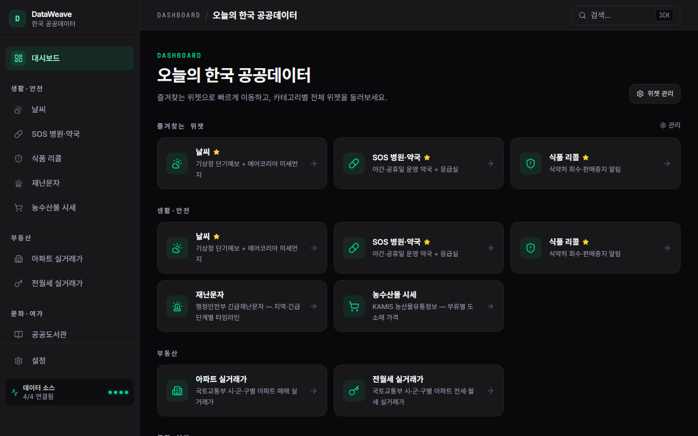

# DataWeave

한국 공공데이터 조회형 위젯 대시보드. 날씨 · SOS 병원·약국 · 식품 리콜 · 재난문자 · 농수산물 시세 · 아파트 매매/전월세 · 공공도서관 · 관광·전시 · 로또 — **10종 위젯**을 한 곳에서.

**🔗 Live:** <https://data-weave-psi.vercel.app>



> Phase 1 + 1.5 완성 — 위젯 10종, 위젯별 상세 페이지, 즐겨찾기, 카카오맵 mini 지도, 인앱 알림 배지. Vercel(icn1)에 live 배포 중. 알림 인프라(Web Push)는 Phase 2. 자세한 설계는 [docs/PLAN.md](docs/PLAN.md), [docs/DESIGN.md](docs/DESIGN.md), [docs/TODOS.md](docs/TODOS.md), 위젯별 [docs/widgets/](docs/widgets/) 참고.

## 로컬 개발

```bash
npm install
cp .env.example .env.local   # 키 채우기
npm run dev                  # http://localhost:3000
```

### 필요한 API 키

`.env.local`에 최소한:

```
DATA_GO_KR_KEY=         # data.go.kr 발급 키 (날씨/SOS/아파트 매매·전월세 공유)
FOODSAFETY_API_KEY=     # foodsafetykorea.go.kr 별도 발급 (식품 리콜)
```

**키 없어도 자동으로 mock 데이터로 폴백**되어 위젯이 동작합니다. 위젯을 늘려 쓰려면 아래 키도 추가 — 전체 목록·발급 방법은 [.env.example](.env.example) 주석 참고:

```
LIBRARY_API_KEY=        # 정보나루 도서관 (없으면 DATA_GO_KR_KEY 폴백)
TOUR_API_KEY=           # 한국관광공사 TourAPI
KAMIS_API_KEY= + KAMIS_CERT_ID=   # 농수산물 시세 (둘 다 필요)
DISASTER_API_KEY=       # 긴급재난문자 (없으면 DATA_GO_KR_KEY 폴백)
NEXT_PUBLIC_KAKAO_MAP_KEY=        # 카카오맵 mini 지도 (없으면 지도만 숨김)
```

로또(`lotto`)는 키가 필요 없습니다 (공개 endpoint).

#### data.go.kr 활용신청이 필요한 서비스

같은 키 하나로 다음 서비스 모두 사용. 각각 `활용신청` 한 번씩:

- 기상청_단기예보 ((구)_동네예보) 조회서비스 — https://www.data.go.kr/data/15084084/openapi.do
- 기상청_중기예보 조회서비스 — https://www.data.go.kr/data/15059468/openapi.do
- 한국환경공단_에어코리아_대기오염정보 — https://www.data.go.kr/data/15073861/openapi.do
- 국립중앙의료원_전국 응급의료기관 정보 조회 서비스 — https://www.data.go.kr/data/15000563/openapi.do
- 국립중앙의료원_전국 약국 정보 조회 서비스 — https://www.data.go.kr/data/15000578/openapi.do
- 국토교통부_아파트 매매/전월세 실거래가 (RTMS, 15126469 등)

#### 별도 시스템 (data.go.kr 키 호환 X — 각자 가입·발급)

- **식품 리콜**: https://www.foodsafetykorea.go.kr 가입 → "식품의 회수 및 판매중지 정보" 이용신청 → 인증키
- **도서관**: https://www.data4library.kr (정보나루) 인증키
- **농수산물 시세**: https://www.kamis.or.kr OpenAPI 신청 → 인증키 + 요청자 id
- **재난문자**: https://www.safetydata.go.kr 가입 + 활용신청
- **카카오맵**: https://developers.kakao.com → 앱 추가 → Web 플랫폼(localhost + 배포 URL) → JavaScript 키

## 빌드

```bash
npm run build   # production build (Turbopack)
```

## 배포 (Vercel) — live

이미 Vercel에 배포되어 있습니다. SSR 리전은 `vercel.json`에서 `icn1`(서울)로 고정. **`git push origin main` → 자동 재배포.**

처음부터 다시 셋업한다면:

1. https://vercel.com → "Add New Project" → GitHub 저장소(`hgko1207/data-weave`) Import.
2. Framework: Next.js 자동 감지.
3. Environment Variables에 위 "필요한 API 키"의 값들을 등록 (최소 `DATA_GO_KR_KEY` + `FOODSAFETY_API_KEY`, 나머지는 쓰는 위젯만).
4. Deploy → 자동 도메인(`*.vercel.app`) 발급.

> Supabase는 Phase 1에선 옵션. 위젯 인스턴스를 DB에 저장하려면 [supabase/migrations/0001_widgets.sql](supabase/migrations/0001_widgets.sql) 적용 후 `.env`에 Supabase 키 등록. 현재 데모 대시보드는 [src/app/(dashboard)/page.tsx](src/app/(dashboard)/page.tsx) 안에 인스턴스가 하드코딩되어 있어 DB 없이도 동작.

## PWA 설치

- 데스크톱(Chrome/Edge): 주소창 오른쪽 "설치" 아이콘
- iOS Safari: 공유 버튼 → "홈 화면에 추가"
- 방문 3회 이상 + 활성 위젯 1개 이상이면 자동 설치 배너 표시

## 새 위젯 추가

5분이면 됩니다. [src/widgets/README.md](src/widgets/README.md) 가이드 참고.
